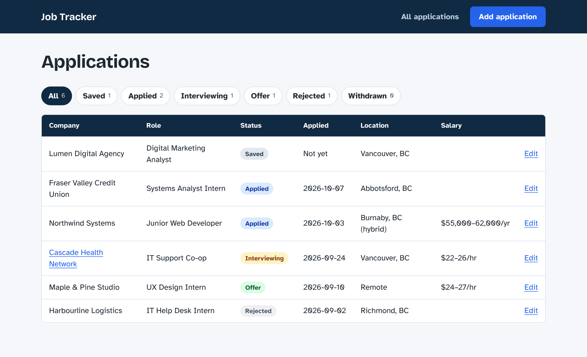
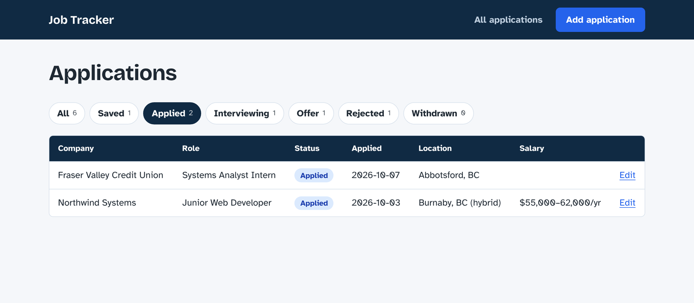
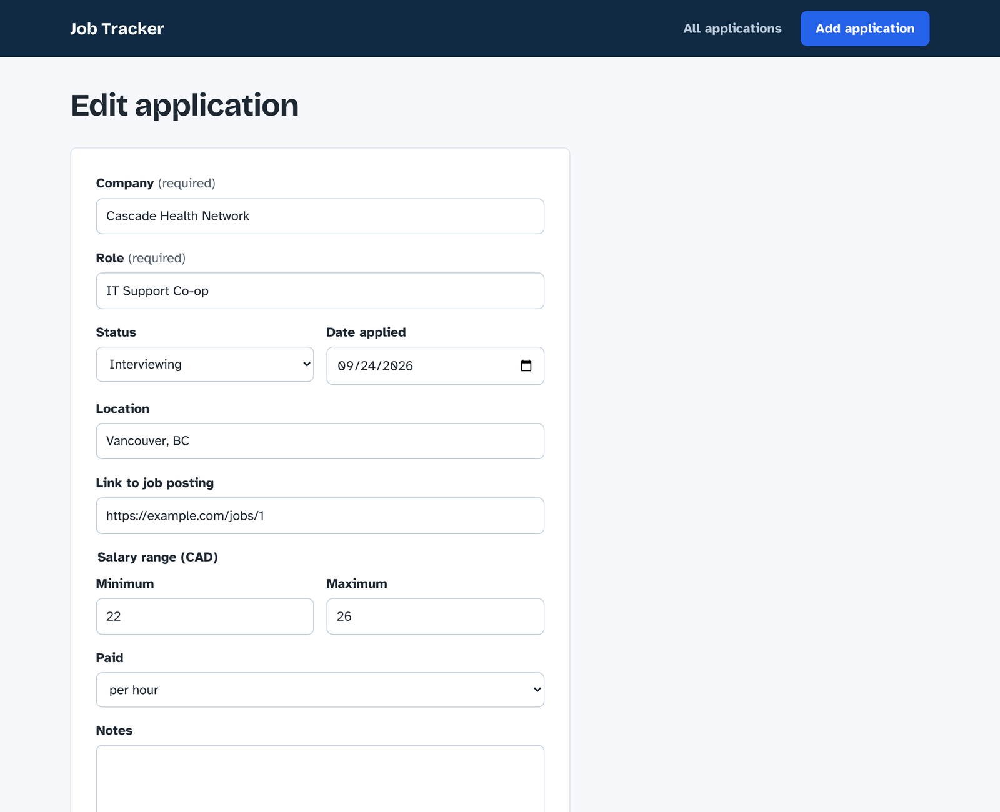

# Job Application Tracker

A web app for keeping track of job applications in one place: add each job you apply to, update its status as you hear back, and filter the list to see what needs attention.

Built with **Python, Flask and SQLite** by [Raymond Adegbuyi](https://raymondadegbuyi-hue.github.io) as a portfolio project.



*Screenshots use made-up demo data.*

## Features

- **Add applications** with company, role, status, date applied, location, a link to the posting, a salary range (hourly or yearly) and notes
- **Update** any application, for example moving it from Applied to Interviewing
- **Filter by status** (Saved, Applied, Interviewing, Offer, Rejected, Withdrawn), with a count for each
- **Delete** applications, with a confirmation step
- **Validation** with clear error messages; the form keeps what you typed when something needs fixing
- **Responsive and accessible**: works on phones, supports keyboard navigation, and every color pair meets WCAG AA contrast

| Filter by status | Edit an application |
|---|---|
|  |  |

## Tech stack

| Part | Tool |
|---|---|
| Backend | Python 3.14, Flask 3.1 |
| Database | SQLite |
| Templates | Jinja (included with Flask) |
| Frontend | HTML and CSS, no framework |

## Run it on your computer

You need Python 3 installed.

```bash
git clone https://github.com/Raymondadegbuyi-hue/job-application-tracker.git
cd job-application-tracker

python3 -m venv .venv
source .venv/bin/activate          # On Windows: .venv\Scripts\activate
pip install -r requirements.txt

flask --app app init-db            # creates the database (run once)
flask --app app run --debug --port 5001
```

Then open http://127.0.0.1:5001.

> **macOS note:** port 5000 is often taken by AirPlay Receiver, which is why these commands use port 5001.

> **Warning:** `init-db` deletes and recreates the table. Run it once, not every time.

## Project structure

```
app.py              Routes: list, add, edit, delete, plus form validation
db.py               Database connection and the init-db command
schema.sql          The applications table and its rules
templates/          HTML pages (Jinja templates)
  base.html         Shared layout: header and messages
  index.html        Applications list with status filters
  form.html         Add / edit form
static/style.css    Styles
```

## Security and data quality

- **SQL injection:** every query uses parameterized placeholders (`?` and `:name`), so user input is never mixed into SQL commands.
- **Cross-site scripting (XSS):** Jinja escapes all output, and job links must start with `http://` or `https://`, which blocks `javascript:` links.
- **Delete only accepts POST** requests, so it can't be triggered by simply visiting a URL.
- **Validation in three layers:** the browser form, the Python code, and `CHECK` / `NOT NULL` rules in the database itself.
- **Your data stays private:** the database file lives in `instance/`, which Git ignores.

## What I learned

- How a request travels from the browser to a Flask route and back as a response
- Designing a database schema before writing code, and enforcing rules in the database itself
- The four CRUD operations (create, read, update, delete) in SQL and Flask
- Common web security risks and how to prevent them
- Debugging real issues, such as a port conflict with macOS AirPlay and a layout bug found while testing at phone width

## Possible next steps

- User accounts, so more than one person could use it
- Search by company or role, and sorting by date
- Deploying it online with a production server
